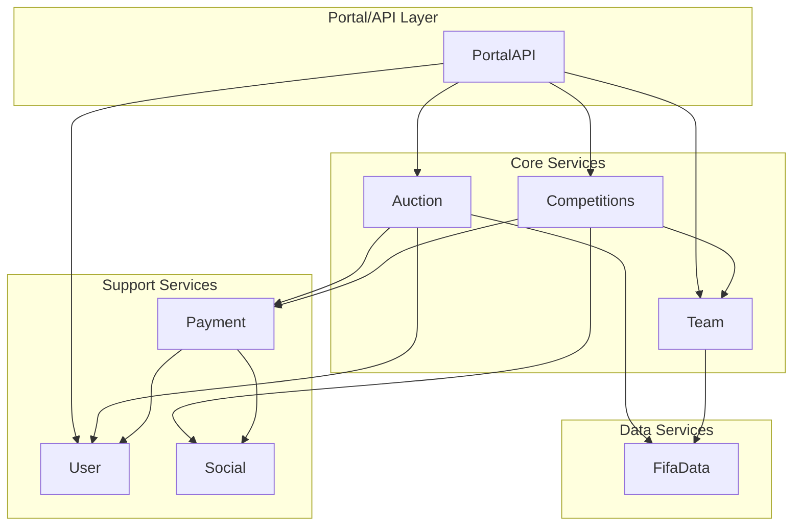

# Documentação Completa - Análise de Quanta

## Grafo de Dependências



## O que é Quanta?

**Quanta** é o número de componentes independentes (conexos) em um grafo de dependências após aplicar as regras de implantação. É uma métrica que mede:

- **Quanta = 1**: Todos os componentes estão acoplados (monólito)
- **Quanta > 1**: Componentes podem ser implantados separadamente (microsserviços)

## Como o Quanta é Calculado

O cálculo usa o algoritmo **Union-Find** (Achieve-Disjoint Set) para unir componentes que:

1. **Mesmo artefato**: Componentes implantados no mesmo serviço
2. **Chamada síncrona**: Dependência direta entre componentes
3. **Banco compartilhado**: Todos os componentes atras de um banco compartilhado

---

## Tabela Resumo - 8 Formas de Implantação

| Forma | Artefatos | Remotas | Diretas | Sinc. | Com Fila | Banco Comp. | Banco Único |
|-------|-----------|---------|---------|-------|----------|-------------|-------------|
| **Monólito Modular** | 1 | 0 | 0 | 1 | 1 | 1 | 1 |
| **Extração do Candidato** | 2 | 4 | 1 | 1 | 1 | 1 | 1 |
| **Por Domínio (Service-Based)** | 5 | 10 | 3 | 1 | 1 | 1 | 1 |
| **Service-Based Agrupado** | 5 | 10 | 3 | 1 | 1 | 1 | 1 |
| **Microsserviços** | 8 | 13 | 3 | 1 | 2 | 1 | 1 |
| **Por Fluxo de Negócio** | 3 | 9 | 2 | 1 | 1 | 1 | 1 |
| **Híbrida** | 4 | 9 | 3 | 1 | 1 | 1 | 1 |
| **Por Transação** | 3 | 7 | 1 | 1 | 1 | 1 | 1 |

---

## Análise Detalhada por Forma

### 1. Monólito Modular
- **Descrição**: Todos os 8 componentes em um único artefato
- **Vantagem**: Simplicidade, menor latência
- **Desvantagem**: Dificuldade de escalabilidade, deploy completo
- **Quanta**: 1 (todos acoplados)

### 2. Extração do Candidato (Payment)
- **Descrição**: Payment extraído para serviço separado, resto em monolito
- **Artefatos**: 2 (Monolito + ServicoPagamentos)
- **Arestas remotas**: 4 (Auction→Payment, Payment→User, Payment→Social, Competitions→Payment)
- **Chamadas diretas de Auction**: 1 (para Payment)
- **Quanta**: 1 (banco compartilhado conecta tudo)

### 3. Por Domínio (Service-Based)
- **Descrição**: Agrupamento pelos 5 domínios da Aula 12
- **Artefatos**: 5 (Mercado, GestaoElencos, Competicoes, Financeiro, Notificacoes)
- **Componentes por domínio**:
  - Mercado: PortalAPI, Auction
  - Gestão Elencos: Team, FifaData
  - Competições: Competitions
  - Financeiro: Payment, User
  - Notificações: Social
- **Quanta**: 1 (banco compartilhado)

### 4. Service-Based Agrupado
- **Descrição**: Igual ao service-based, mas Payment junto com Competitions
- **Uso**: Quando Payment e Competitions são logicamente próximos
- **Quanta**: 1

### 5. Microsserviços
- **Descrição**: Cada componente em seu próprio serviço
- **Artefatos**: 8 (um por componente)
- **Arestas remotas**: 13 (todas as dependências)
- **Chamadas diretas de Auction**: 3 (para User, Payment, FifaData)
- **Quanta**: 1 (banco compartilhado)

### 6. Por Fluxo de Negócio
- **Descrição**: Agrupa componentes por fluxos principais
- **Artefatos**: 3
  - **Leilao**: Auction, FifaData
  - **Competicoes**: Competitions, Team, Payment
  - **Portal**: PortalAPI, User, Social
- **Quanta**: 1

### 7. Híbrida
- **Descrição**: Combinação de monolito com extrações
- **Artefatos**: 4
  - **Core**: Auction, PortalAPI, Competitions
  - **Financeiro**: Payment, User
  - **Notificacoes**: Social
  - **Dados**: FifaData, Team
- **Quanta**: 1

### 8. Por Transação
- **Descrição**: Agrupa componentes por transações críticas
- **Artefatos**: 3
  - **Checkout**: Auction, Payment, User
  - **Elencos**: Team, FifaData
  - **Portal**: PortalAPI, Competitions, Social
- **Quanta**: 1

---

## Por que o Quanta é Sempre 1?

**Resposta**: Porque todos os testes usam `banco_compartilhado=True`.

Quando o banco é compartilhado:
- Todos os componentes atras do banco compartilhado ficam logicamente acoplados
- Mesmo que haja 8 serviços, eles compartilham o mesmo banco de dados
- Isso cria um ponto de acoplamento único → Quanta = 1

**Para obter Quanta > 1**, use `--banco-unico` ou `banco_compartilhado=False`.

---

## Redução de Quanta com Filas

### Análise para Microsserviços

Com `banco_compartilhado=False`:
- **Quanta atual**: 1 (o grafo tem arestas que conectam todos os componentes)
- **Menor conjunto de arestas para reduzir**: Nenhum conjunto reduz o quanta

**Por que nenhum conjunto basta?**
- O grafo do Marketplace Orion tem arestas que formam uma cadeia conectiva
- Mesmo removendo arestas (tornando-as assíncronas), os componentes permanecem conectados
- O quanta depende da estrutura do grafo, não apenas das arestas

### Para formas com banco compartilhado

**Nenhum conjunto de arestas reduz o quanta** porque:
- O banco compartilhado já conecta todos os componentes
- Mesmo que você coloque arestas em fila, o banco continua sendo ponto de acoplamento
- A redução de quanta só acontece quando o banco é dividido por serviço

---

## Comandos Úteis

```bash
# Análise padrão (banco compartilhado)
python quantum.py

# Com banco único (cada serviço tem seu próprio banco)
python quantum.py --banco-unico

# Arestas específicas via fila
python quantum.py --assincronas "Payment>Social,Auction>User"

# Gerar tabela resumo
python quantum.py --tabela

# Forma personalizada
python quantum.py --particao "PortalAPI,Auction|Payment,User"
```

---

## Hipóteses Usadas

| Métrica | Valor | Fonte |
|---------|-------|-------|
| Taxa de falha por chamada remota | 2% | Aula 16 |
| Disponibilidade por artefato | 99.9% | Aula 16 |
| Minutos no mês | 43.200 | 30 dias × 24 horas × 60 minutos |

---

## Conclusões

1. **Monólito modular** é a forma mais simples, mas menos escalável
2. **Microsserviços** oferece maior isolamento, mas maior complexidade
3. **Formas híbridas** (fluxo de negócio, transação) oferecem equilíbrio entre simplicidade e escalabilidade
4. **Banco compartilhado** reduz o quanta a 1, independentemente da forma
5. **Filas** reduzem a latência e a cadeia de falhas, mas não reduzem o quanta com banco compartilhado