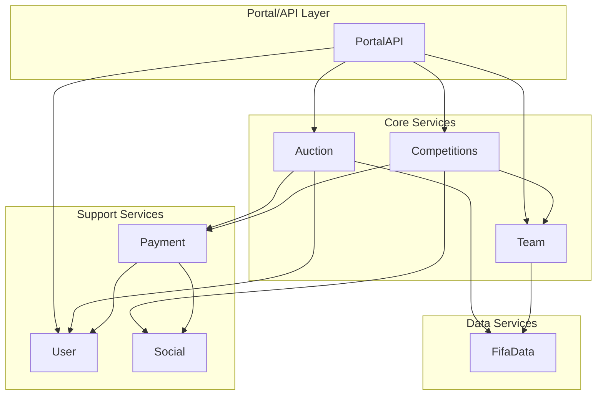
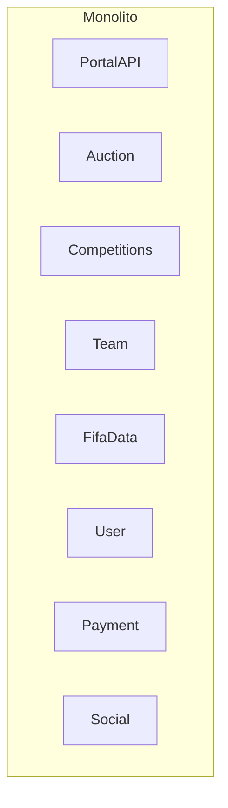
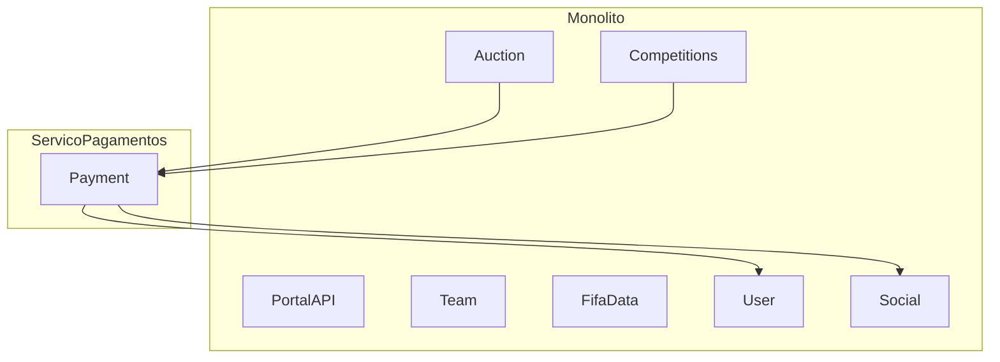
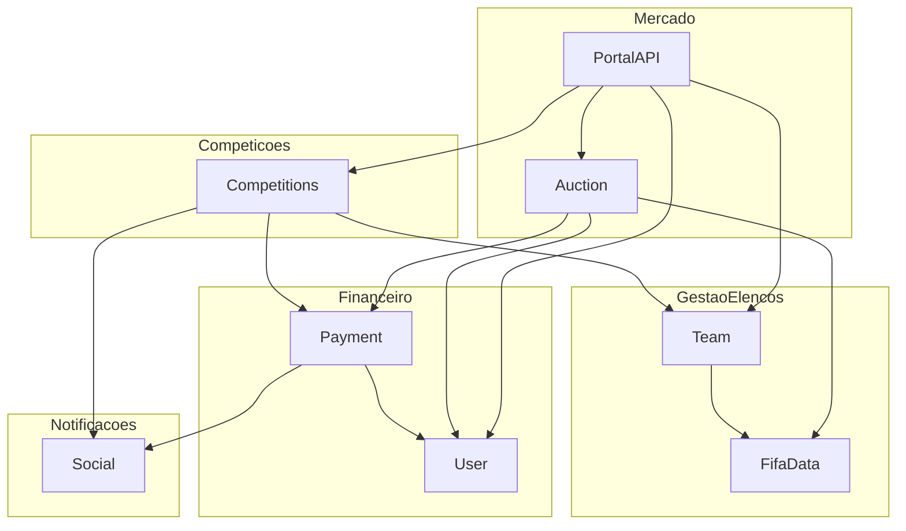
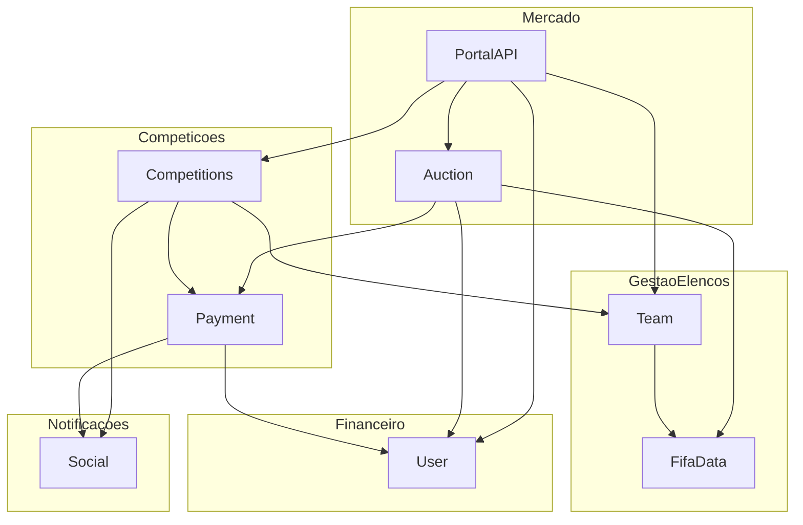
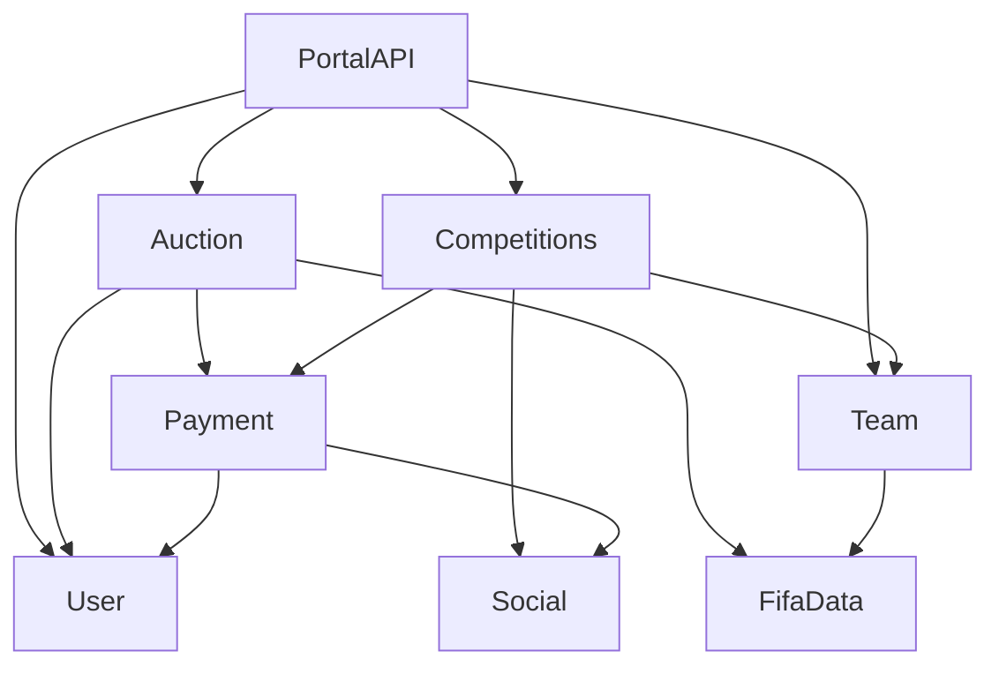
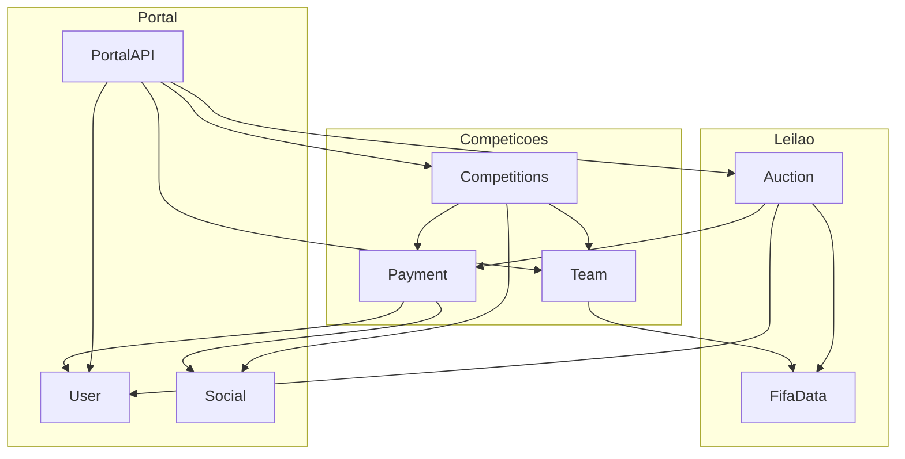
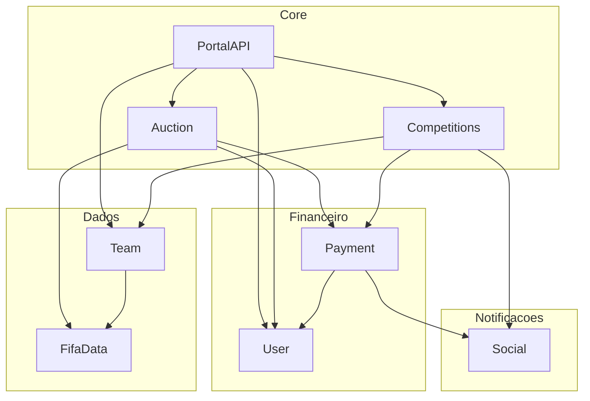
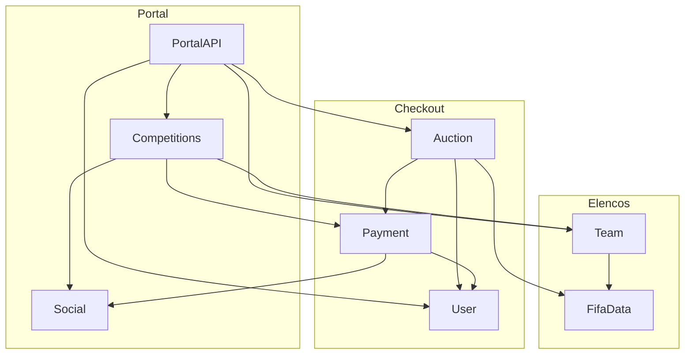

# Diagramas Mermaid - Formas de Implantação do FIFA Auction Hub

## Grafo Original de Dependências

---

## 1. Monólito Modular

**Descrição**: Todos os 8 componentes em um único artefato.

**Métricas**:
- Artefatos: 1
- Arestas remotas: 0
- Chamadas diretas de Auction: 0
- Quanta (sincrono): 1

---

## 2. Extração do Candidato (Payment)

**Descrição**: Payment extraído para serviço separado, resto em monolito.

**Métricas**:
- Artefatos: 2
- Arestas remotas: 4
- Chamadas diretas de Auction: 1
- Quanta (sincrono): 1

---

## 3. Por Domínio (Service-Based)

**Descrição**: Agrupamento pelos 5 domínios da Aula 12.

**Métricas**:
- Artefatos: 5
- Arestas remotas: 10
- Chamadas diretas de Auction: 3
- Quanta (sincrono): 1

---

## 4. Service-Based Agrupado

**Descrição**: Payment junto com Competitions no mesmo artefato.

**Métricas**:
- Artefatos: 5
- Arestas remotas: 10
- Chamadas diretas de Auction: 3
- Quanta (sincrono): 1

---

## 5. Microsserviços

**Descrição**: Cada componente em seu próprio serviço.

**Métricas**:
- Artefatos: 8
- Arestas remotas: 13
- Chamadas diretas de Auction: 3
- Quanta (sincrono): 1 (com banco compartilhado)

---

## 6. Por Fluxo de Negócio

**Descrição**: Agrupa componentes por fluxos principais.

**Métricas**:
- Artefatos: 3
- Arestas remotas: 9
- Chamadas diretas de Auction: 2
- Quanta (sincrono): 1

---

## 7. Híbrida

**Descrição**: Combinação de monolito com extrações.

**Métricas**:
- Artefatos: 4
- Arestas remotas: 9
- Chamadas diretas de Auction: 3
- Quanta (sincrono): 1

---

## 8. Por Transação

**Descrição**: Agrupa componentes por transações críticas.

**Métricas**:
- Artefatos: 3
- Arestas remotas: 7
- Chamadas diretas de Auction: 1
- Quanta (sincrono): 1

---

## Tabela Resumo

| Forma | Artefatos | Remotas | Diretas | Sinc. | Com Fila | Banco Comp. | Banco Único |
|-------|-----------|---------|---------|-------|----------|-------------|-------------|
| **Monólito Modular** | 1 | 0 | 0 | 1 | 1 | 1 | 1 |
| **Extração do Candidato** | 2 | 4 | 1 | 1 | 1 | 1 | 1 |
| **Por Domínio (Service-Based)** | 5 | 10 | 3 | 1 | 1 | 1 | 1 |
| **Service-Based Agrupado** | 5 | 10 | 3 | 1 | 1 | 1 | 1 |
| **Microsserviços** | 8 | 13 | 3 | 1 | 2 | 1 | 1 |
| **Por Fluxo de Negócio** | 3 | 9 | 2 | 1 | 1 | 1 | 1 |
| **Híbrida** | 4 | 9 | 3 | 1 | 1 | 1 | 1 |
| **Por Transação** | 3 | 7 | 1 | 1 | 1 | 1 | 1 |

---

## Análise: Por que o Quanta é Sempre 1?

**Resposta**: Porque todos os testes usam `banco_compartilhado=True`.

Quando o banco é compartilhado:
- Todos os componentes atras do banco compartilhado ficam logicamente acoplados
- Mesmo que haja 8 serviços, eles compartilham o mesmo banco de dados
- Isso cria um ponto de acoplamento único → Quanta = 1

**Para obter Quanta > 1**, use `--banco-unico` ou `banco_compartilhado=False`.

---

## Redução de Quanta com Filas

### Para Microsserviços

Com `banco_compartilhado=False`:
- **Quanta atual**: 1 (o grafo tem arestas que conectam todos os componentes)
- **Menor conjunto de arestas para reduzir**: Nenhum conjunto reduz o quanta

**Por que nenhum conjunto basta?**
- O grafo do Marketplace Orion tem arestas que formam uma cadeia conectiva
- Mesmo removendo arestas (tornando-as assíncronas), os componentes permanecem conectados
- O quanta depende da estrutura do grafo, não apenas das arestas

### Para formas com banco compartilhado

**Nenhum conjunto de arestas reduz o quanta** porque:
- O banco compartilhado já conecta todos os componentes
- Mesmo que você coloque arestas em fila, o banco continua sendo ponto de acoplamento
- A redução de quanta só acontece quando o banco é dividido por serviço

---

## Hipóteses Usadas

| Métrica | Valor | Fonte |
|---------|-------|-------|
| Taxa de falha por chamada remota | 2% | Aula 16 |
| Disponibilidade por artefato | 99.9% | Aula 16 |
| Minutos no mês | 43.200 | 30 dias × 24 horas × 60 minutos |